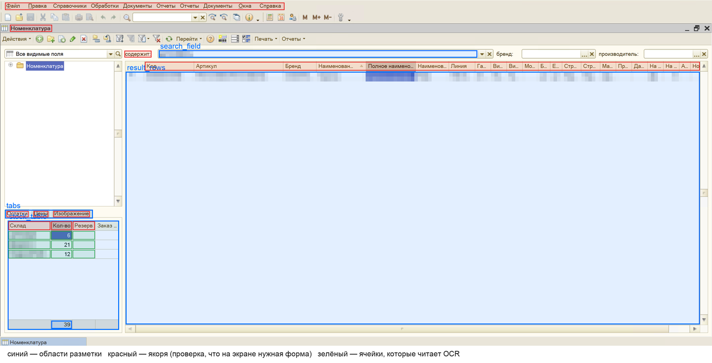

# orderbot

Робот проверяет FBS-заказы Ozon, Яндекс Маркета и Wildberries по остаткам и ценам в 1С.
Решение по каждому заказу он отправляет менеджеру в Telegram: с причиной, если что-то не
так, и с кнопками «Собрать» / «Отменить». Есть и режим автоматического подтверждения
сборки через API площадки (`confirm`). Он реализован и покрыт тестами, но в проде пока
выключен.

Главное ограничение: у 1С нет API, есть только RDP-сессия сотрудника. Поэтому робот
работает с 1С как человек: снимает окно Remote Desktop, распознаёт ячейки таблиц и вводит
артикул синтетическими событиями macOS. Ошибка здесь стоит денег: подтверждён заказ,
которого нет на складе, или продажа ниже минимальной цены. Поэтому весь проект построен
вокруг одного правила: **не уверен — не действуй, отдай человеку**.

**Статус.** В работе с 3 ноября 2026: две компании-продавца, три площадки. По журналу
SQLite за первые две недели — 236 заказов, 250 проверок. Все площадки в режиме `observe`,
WB — только в нём (`bot.OBSERVE_ONLY`). В 16 % проверок робот признал чтение 1С
неуверенным и передал заказ человеку.



## Как это работает

```
 Ozon / Я.Маркет / WB API ──► Pipeline ──► 1С через экран ──► rules.decide_order ──┬─► Telegram: решение, причина, кнопки
        (опрос)                 │          (захват, OCR)        (остаток, цена)    └─► confirm через API (если включён)
                                └── SQLite: состояние заказа, журнал, outbox
```

1. **Опрос площадок** (`marketplaces/`). Адаптеры приводят заказы трёх API к одной модели
   `Order`: артикул, количество, склад, сколько заплатил покупатель.
2. **Чтение 1С** (`screen/`). Поиск артикула, вкладки «Остатки» и «Цены», распознавание
   таблиц. Подробности ниже.
3. **Решение** (`rules.py`). Это чистая функция, без побочных эффектов. Свободный остаток =
   количество − уже собранное. Если заказ влезает только в резерв, робот спрашивает
   менеджера. Минимальная цена берётся из цен 1С (EPR/PPR) с поправкой на скидки бренда,
   соинвест площадки и список фиксированных цен. Результат: `CONFIRM`, `ASK_RESERVE` или
   `ESCALATE` со списком причин.
4. **Действие** (`pipeline.py`). У каждой площадки свой режим, `observe` (по умолчанию) или
   `confirm`:
   - Перед подтверждением статус заказа перечитывается.
   - Состояние заказа и очередь сообщений (outbox) хранятся в SQLite. Повторная обработка
     не даёт второго подтверждения или второго сообщения.

## Чтение экрана

Шрифт 1С мелкий, а RapidOCR не знает кириллицы. Поэтому распознавание собрано из
простых проверяемых частей:

- **Стабильный кадр.** Кадр читается, только если два снимка подряд совпали.
- **Проверка экрана.** Якоря — маски «чернил» эталонных фрагментов: меню, заголовок формы,
  строка статуса. На картинке выше они красные. Если якоря не совпали, это не та форма:
  робот ничего не нажимает и останавливается.
- **Числа читаются двумя независимыми движками.** Первый сопоставляет глифы с шаблонами,
  снятыми с этого же экрана (`screen/calibrate.py`). Второй — RapidOCR. Число принимается,
  только если оба дали одно значение (`reader._both_engines`).
- **Кириллица** (склады, вкладки) сравнивается с эталонными вырезками и в свободный текст
  не распознаётся.
- **Нет уверенности — нет значения.** Функции распознавания бросают `Refused` /
  `ReadUncertain`, и заказ уходит человеку с причиной. Значение никогда не угадывается.

### Качество распознавания

`scripts/eval_ocr.py` берёт 52 числовые ячейки с ручной разметкой
(`layouts/shots/labels.yaml`) с 12 реальных кадров из прода. Сами кадры в открытый репозиторий
не попали, на них каталог, цены и остатки компании. Таблица ниже — результат прогона на них. Каждую ячейку он искажает и
смотрит, что ответит каждая стратегия. Пустые ячейки не учитываются: робот читает их как 0
без OCR. Все 11 строк отчёта, в ячейках: % верно / % отказ / **% тихая ошибка**.

| искажение | шаблоны глифов | RapidOCR | оба должны совпасть (прод) |
|---|---|---|---|
| без искажений | 100 / 0 / **0** | 100 / 0 / **0** | 100 / 0 / **0** |
| шум σ=8 | 100 / 0 / **0** | 100 / 0 / **0** | 100 / 0 / **0** |
| шум σ=16 | 96 / 4 / **0** | 100 / 0 / **0** | 96 / 4 / **0** |
| размытие r=0.7 | 96 / 4 / **0** | 100 / 0 / **0** | 96 / 4 / **0** |
| размытие r=1.2 | 0 / 100 / **0** | 100 / 0 / **0** | 0 / 100 / **0** |
| контраст ×0.6 | 100 / 0 / **0** | 100 / 0 / **0** | 100 / 0 / **0** |
| JPEG q=50 | 92 / 8 / **0** | 100 / 0 / **0** | 92 / 8 / **0** |
| JPEG q=20 | 75 / 25 / **0** | 100 / 0 / **0** | 75 / 25 / **0** |
| масштаб ×0.75 | 35 / 65 / **0** | 100 / 0 / **0** | 35 / 65 / **0** |
| рамка ячейки сдвинута на 2 px | 96 / 4 / **0** | 92 / 0 / **7.7** | 88 / 12 / **0** |
| рамка ячейки сдвинута на 4 px | 96 / 4 / **0** | 100 / 0 / **0** | 96 / 4 / **0** |

Что видно из таблицы:
- **RapidOCR устойчив к шуму и размытию, но молча ошибается**, когда рамка съехала и цифра
  обрезана. Он выдаёт другое число и не сообщает о сомнении.
- **Шаблоны отказываются** при любом заметном изменении рендеринга, но ни разу не
  ошиблись.
- **В проде нужно согласие обоих.** За это платим большим числом отказов, а тихих ошибок не
  было ни в одном из 11 условий. Выборка маленькая: 52 ячейки дают верхнюю границу около
  6 % на условие (правило трёх, 95 %). Это оценка, а не гарантия. Для задачи такой обмен
  правильный: отказ стоит минуту менеджера, ошибка — подтверждённый заказ без товара.
- **Скорость:** шаблоны ~3 мс на ячейку, RapidOCR ~200 мс на CPU.

**Почему не VLM и не OCR с кириллицей.** Читать нужно числа и заранее известные подписи на
одном и том же экране. Здесь важна способность отказаться, а не охват. Генеративная модель
отвечает всегда, и её уверенность плохо откалибрована. Шаблоны с этого же экрана дают
детерминированный отказ, работают за миллисекунды и локально: данные 1С никуда не
уходят.

## Безопасность

Робот работает в живой 1С под учёткой сотрудника, с правами на запись. Поэтому
ограничения зашиты в код и проверяются тестами:

| Инвариант | Где обеспечен |
|---|---|
| Робот никогда не отменяет заказ | `tests/test_no_cancel.py` разбирает `src/` через AST и ищет любые вызовы отмены. Отменить можно только кнопкой человека (`human_actions.py`) |
| В 1С только белый список действий: × у поля поиска, ввод, Enter, один клик по строке, вкладки | `screen/guard.py` — единственный модуль, который отдаёт команды ввода. Тест фиксирует его публичный API |
| Единственное, что робот закрывает, — окно 1С «Оповещение о задачах» | `Guard.dismiss_task_notice`: не больше двух кликов по ×, только на кадре, опознанном по своим якорям |
| Ввод без модификаторов, только символы без Shift | Remote Desktop теряет синтетические Ctrl/Cmd/Shift (`guard.TYPABLE`) |
| Робот не мешает человеку за этим же Mac | `screen/idle.py`: пока мышь или клавиатура использовались меньше N секунд назад, ввода нет. События робота помечены и не считаются |
| Любой другой неожиданный экран — стоп | `UnexpectedScreen` → пауза и одно сообщение в Telegram |

## Что ещё умеет

- Две компании-продавца с разными ключами в одном процессе.
- Синхронизация остатков между площадками после продажи (по умолчанию только отчёт, запись
  включается командой).
- Цены в тенге и других валютах переводятся в рубли по курсу ЦБ. Нет курса — заказ уходит
  человеку.
- Фото товара с площадки в сообщении менеджеру. Фото кешируется и на решение не влияет.
- Напоминания об отгрузках по расписанию, этикетки Lamoda в Telegram.
- `python -m orderbot.recon` — сверка заказа, складов и кампаний, только чтение.

## Ограничения

- `confirm` в проде не включён. Ozon `ship` и запись остатков на Ozon, Яндексе и WB ни разу
  не вызывались вживую, они проверены только по документации (`docs/marketplace-api.md`).
- Для Ozon не проверено, за единицу или за строку цена `customer_price` при количестве > 1.
  Пока это неизвестно, такие строки уходят человеку.
- Разметка `layouts/production.yaml` снята с одного монитора. На другом экране нужна новая
  калибровка.
- Таблица длиннее окна не читается, потому что робот не прокручивает 1С. Такой заказ уходит
  человеку.
- Набор размеченных кадров маленький (12 кадров, 52 ячейки).

## Стек и устройство

- **Стек:** Python 3.12, asyncio, httpx, aiogram 3, SQLite, Pillow + NumPy, RapidOCR (ONNX
  Runtime), pyobjc (Quartz Event Services, Accessibility API). Работает на macOS рядом с
  Microsoft Remote Desktop.
- **Потоки.** Экран и OCR блокирующие, поэтому работают в отдельном потоке
  (`asyncio.to_thread`) строго по одной операции. Хранилищем и Telegram владеет только
  поток event loop.
- **Ошибки.** Это демон, поэтому вызовы внешних систем (API, Telegram, журнал) обёрнуты
  широким `except`. Ошибка логируется, заказ остаётся в очереди или уходит человеку,
  процесс не падает. Решения о заказе принимаются только по узким исключениям
  (`ReadUncertain`, `UnexpectedScreen`, `*ConfirmError`).
- **Язык.** Код, комментарии и docs — на английском. Тексты для людей — на русском:
  Telegram, ошибки настройки, расписание отгрузок.

```
src/orderbot/
  main.py            точка входа, циклы опроса
  pipeline.py        жизненный цикл заказа
  rules.py           решение по остатку и цене (чистая функция)
  store.py           SQLite: заказы, журнал, outbox, настройки
  bot.py, alerts.py  Telegram: сообщения, кнопки, команды
  marketplaces/      адаптеры Ozon, Яндекс Маркета, WB
  screen/            1С: окно, ввод, idle-gate, OCR, разметка, калибровка
layouts/             разметка экрана, эталонные глифы и подписи
tests/               1286 тестов
docs/                какие методы API площадок проверены вживую, а какие нет
scripts/             запуск, пробное чтение одного артикула, оценка OCR
```

## Запуск

Нужны macOS, Python 3.12 и [uv](https://docs.astral.sh/uv/). Терминалу нужно дать
разрешения «Универсальный доступ» и «Запись экрана».

```bash
uv sync
cp .env.example .env && chmod 600 .env          # ключи площадок, токен бота, ID чатов
cp warehouses.example.yaml warehouses.yaml       # склад площадки -> склад в 1С
cp shipments.example.yaml shipments.yaml         # расписание отгрузок (необязательно)
cp price_exceptions.example.txt price_exceptions.txt
scripts/run.sh --check && scripts/run.sh
```

`LAYOUT_FILE` в `.env.example` указывает на разметку автора. Для другого монитора нужна
своя разметка.

### Калибровка экрана

Разметка (`layouts/<name>.yaml`) описывает прямоугольники полей и таблиц на кадре. Шаблоны
глифов и подписей строятся из размеченных вырезок:

```bash
uv run python -m orderbot.screen.calibrate --capture frame.png   # кадр так, как его видит робот
uv run python -m orderbot.screen.calibrate layouts/<name>-crops.yaml
uv run python scripts/trial_read.py "<артикул>"                  # пробное чтение без заказов
```

Калибровка печатает, каких символов не хватает. Если для символа нет шаблона, робот его не
читает: откажется, а не угадает.

## Тесты

```bash
uv sync --extra dev
uv run pytest -q
uv run ruff check .
```

Тесты не ходят в сеть: HTTP подменяется через `respx`, ввод и окно — фейками. Часть тестов
распознавания читает настоящие снимки 1С. Их в этом репозитории нет, поэтому такие тесты
пропускаются с пометкой (`tests/conftest.py`). Полный прогон идёт там, где лежат кадры.
CI (`.github/workflows/ci.yml`) прогоняет ruff и тесты на macOS.
